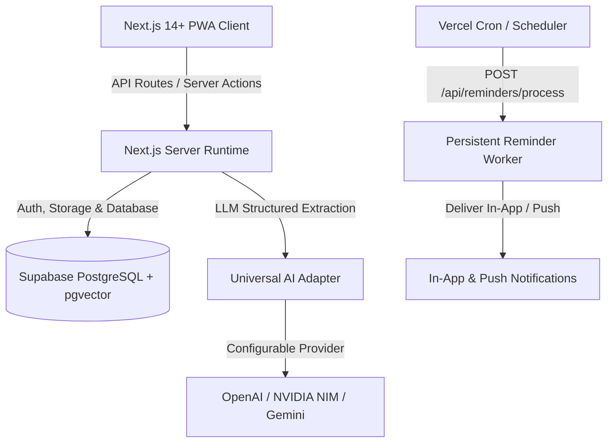

# MEMORAE AI SECOND BRAIN - ARCHITECTURE SPECIFICATION

## Overview
Memorae is a mobile-first Progressive Web App (PWA) that acts as an intelligent personal Second Brain. It enables users to capture notes, tasks, reminders, and documents using conversational English, Hindi, and Hinglish.

---

## 1. High-Level Architecture

---

## 2. Layer Breakdown

### A. Presentation Layer (Mobile-First PWA)
- **Framework**: Next.js 14+ (App Router) with TypeScript.
- **Styling**: Tailwind CSS with dark/light mode support.
- **Ergonomics**: Mobile bottom navigation bar (`Home`, `Assistant`, `Tasks`, `Memory`, `Profile`) + Floating Quick-Capture button.
- **PWA Capabilities**: Service worker caching, Web App Manifest, offline shell, and Push Notifications.

### B. Business & Orchestration Layer
- **AI Intent Engine**: Maps natural speech or text to JSON action calls:
  - `create_task`, `update_task`, `delete_task`, `list_tasks`
  - `create_reminder`, `snooze_reminder`, `postpone_reminder`
  - `save_memory`, `search_memories`
  - `manage_list`
- **Multi-lingual Parser**: Understands mixed English, Hindi, and Hinglish phrasing.
- **Deterministic Date Normalizer**: Resolves relative dates ("kal 10 baje", "next Monday") against the current server time in `Asia/Kolkata`.

### C. Data & Memory Layer (Supabase)
- **PostgreSQL**: Normalized relational tables for tasks, reminders, lists, profiles, and logs.
- **pgvector**: Stores 1536-dimensional embeddings for semantic similarity search in long-term memory.
- **Row Level Security (RLS)**: Enforces complete multi-tenant user isolation.
- **Supabase Storage**: Secure buckets for user-uploaded documents, receipts, and audio voice notes.

### D. Persistent Reminder Scheduling Engine
- Unlike volatile in-browser timers, reminders are persisted in PostgreSQL.
- A secure background endpoint (`/api/reminders/process`) evaluates due reminders, executes delivery logic, and logs status (`delivered`, `snoozed`, `failed`).
