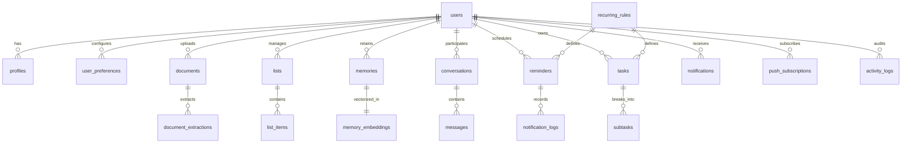

# MEMORAE AI SECOND BRAIN - DATABASE SCHEMA DOCUMENTATION

## Database Engine
- **Engine**: PostgreSQL 15+ (Hosted on Supabase)
- **Extensions**: `uuid-ossp`, `pgcrypto`, `vector`

---

## Normalized Entity Relationships

---

## Table Summary

1. **`profiles`**: User metadata, preferred language, timezone (`Asia/Kolkata`), assistant name, and daily briefing time.
2. **`user_preferences`**: Dark/light theme, active AI provider (`openai` | `nvidia`), model name, and dashboard widgets.
3. **`conversations`**: Chat sessions with the AI Second Brain.
4. **`messages`**: Multi-turn history, speech-to-text transcripts, and structured tool attachments.
5. **`memories`**: Long-term memory store partitioned into categories (`Personal`, `Business`, `People`, `Important Dates`, `Preferences`, `Ideas`, `Notes`, `Documents`, `Financial Commitments`).
6. **`memory_embeddings`**: 1536-dimensional vector representations indexed via IVFFlat for cosine similarity matching.
7. **`tasks`**: Actionable tasks with priorities (`low`, `medium`, `high`, `urgent`), due dates, categories, and completion timestamps.
8. **`subtasks`**: Granular sub-items belonging to a parent task.
9. **`reminders`**: Persistent alarms and notifications with recurrence rules, delivery status, and retry counters.
10. **`recurring_rules`**: Recurrence patterns (daily, weekly, monthly, custom).
11. **`lists` & `list_items`**: Checklists (e.g. shopping, hardware, pending payments).
12. **`documents` & `document_extractions`**: Uploaded receipt, bill, or PDF scans along with structured JSON extracted by Vision/OCR.
13. **`notifications` & `notification_logs`**: In-app notifications and delivery audit trail.
14. **`push_subscriptions`**: Web Push API tokens for Android PWA background notifications.
15. **`activity_logs`**: Audit trail of user actions.

---

## Row Level Security (RLS)
Every table enforces `auth.uid() = user_id`. No user can access, query, or modify another user's records.
